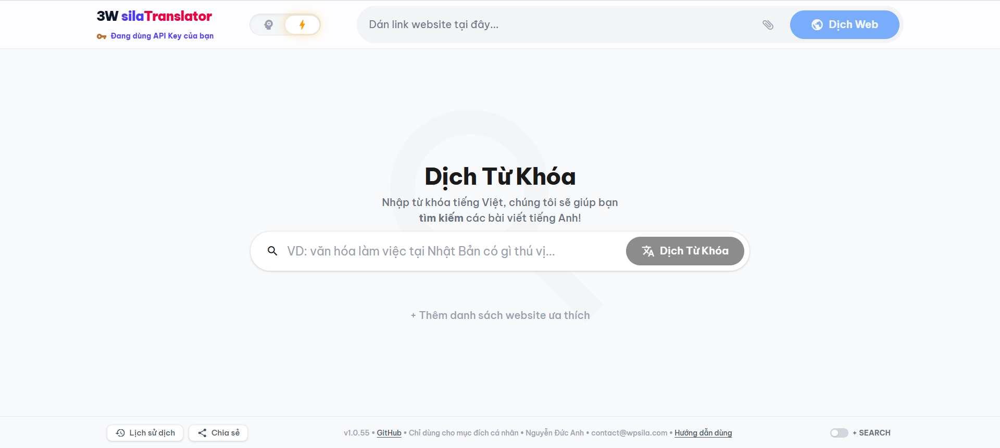

# 3W-silaTranslator
Ứng dụng dịch web từ tiếng Anh sang tiếng Việt. 

  
    <em>Giao diện của 3W-silaTranslator...</em>

- **Link app trên AI Studio**: https://aistudio.google.com/apps/4cc7e19e-46dd-4d38-8617-ba38ef1c80c3?showPreview=true&showAssistant=true&fullscreenApplet=true
- Hướng dẫn sử dụng: https://web-translator.wpsila.com

3W-silaTranslator sử dụng SI/Prompt mẫu `SI-Prompt-WEB-EV-Translate` (v1.0.4) ở đây (cùng tác giả): https://github.com/kiencang/SI-Prompt-WEB-EV-Translate

**Lưu ý**: Từ ngày 28/10/2026, việc sử dụng API Key miễn phí trên AI Studio không được thoải mái như trước đây, thường gặp giới hạn (thông báo dạng `model AI đang có nhu cầu sử dụng cao, vui lòng thử lại sau`). Hiện chỉ Key trả phí là tiện dùng ứng dụng được ngay.

## Lý do tồn tại
Các công cụ dịch web hiện có rất nhiều, tiện dùng ngay trên trình duyệt (ví dụ Chrome, Firefox, v.v..), tuy nhiên chất lượng dịch mặc định của chúng không cao, với nhiều nội dung hơi phức tạp dễ có những đoạn dịch `ngây ngô`. Công cụ này ra đời để khắc phục phần nào nhược điểm đó. Về bản chất nó cũng chỉ là dịch máy, tuy nhiên 3W-silaTranslator sử dụng các model AI mới nhất của Gemini để dịch, giúp tăng cường chất lượng dịch lên đáng kể.

## Một số ưu điểm
- Mạnh mẽ: Tận dụng sức mạnh từ các model hàng đầu (như Gemini Pro hoặc Flash).
- Điều chỉnh cách đọc: Thay đổi font chữ, cỡ chữ, độ rộng dòng, khoảng cách giãn dòng và màu nền để phù hợp nhất với nhu cầu của bạn.
- Lưu trữ lâu dài: Hỗ trợ tải bản dịch về máy cá nhân để lưu trữ lâu dài & đọc lại offline mọi lúc.
- Lịch sử dịch: Lưu 10 bài dịch gần nhất trong trình duyệt để có thể đọc lại nhanh khi cần.

## Tuyên bố từ chối trách nhiệm
Công cụ này có thể được sử dụng cho mục đích nghiên cứu và học tập cá nhân.

3W-silaTranslator cũng như người phát triển nó không đưa ra bất kỳ bảo đảm rõ ràng hay ngụ ý nào, cũng như không tuyên bố rằng công cụ sẽ vận hành hoàn hảo, chính xác hoặc cập nhật. Người phát triển sẽ không chịu trách nhiệm cho bất kỳ tổn thất hay thiệt hại nào phát sinh trực tiếp hoặc gián tiếp liên quan đến hoặc phát sinh từ việc sử dụng công cụ này.

## Ghi công
Một số thư viện quan trọng mà ứng dụng này dùng:

*   **[Angular](https://angular.dev/)**: Lõi chính của ứng dụng.
*   **[Tailwind CSS](https://tailwindcss.com/)**: Xây dựng giao diện chính cho ứng dụng.
*   **[Marked](https://marked.js.org/)**: Chuyển Markdown sang cấu trúc HTML để hiển thị cho người dùng cuối.
*   **[Turndown](https://github.com/mixmark-io/turndown)**: Chuyển đổi ngược định dạng HTML thành cú pháp Markdown.
*   **[Mozilla Readability](https://github.com/mozilla/readability)**: Thư viện bóc tách nội dung chính của một bài báo/trang web (loại bỏ quảng cáo, menu, header...).
*   **[idb (IndexedDB Wrapper)](https://github.com/jakearchibald/idb)**: Thư viện wrap IndexedDB, hỗ trợ xử lý các tác vụ liên quan đến IndexedDB tốt hơn. Toàn bộ dữ liệu bản dịch được lưu cục bộ tại trình duyệt là thông qua IndexedDB.

